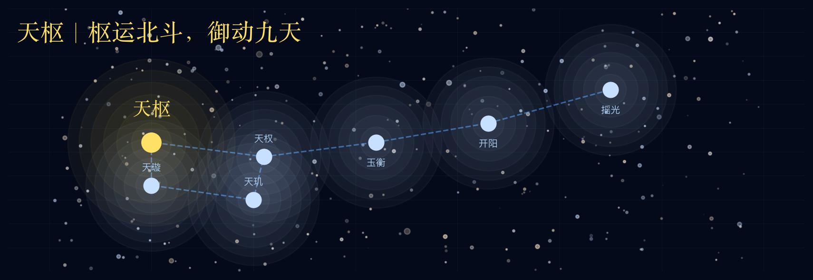
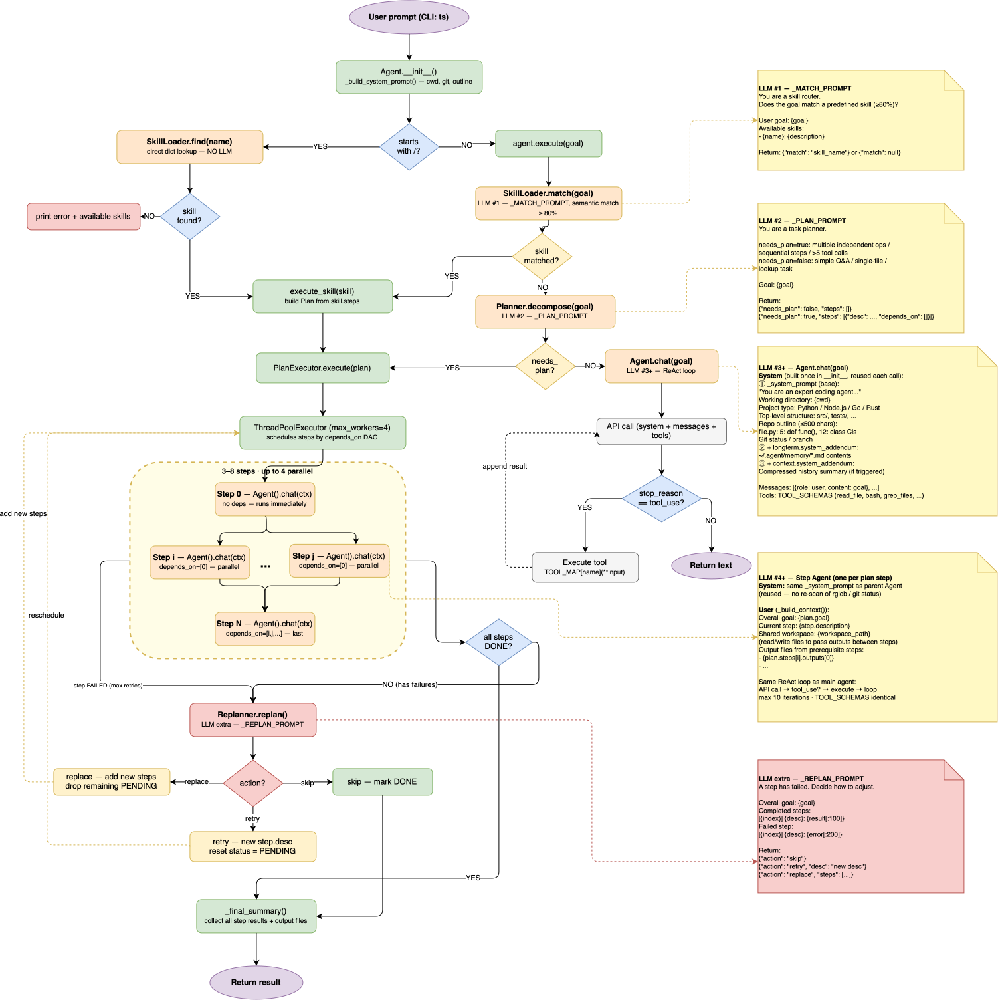

**Tianshu** (天枢, *Celestial Pivot*) is the first star of the Big Dipper — the fixed point around which the northern sky revolves.

Name the goal. Tianshu thinks, plans, and executes — step by step, until done.

**枢运北斗，御动九天。**

说出目标，天枢自行思考、拆解、执行，直至完成。

## Installation

```bash
make install
```

## Setup

Create a `.env` file in your project root:

```bash
ANTHROPIC_API_KEY=your_anthropic_api_key
ANTHROPIC_BASE_URL=http://localhost:6655/anthropic
TAVILY_API_KEY=your_tavily_api_key
```

Then start the agent:

```bash
make run
```

## Features

- **Chat mode**: multi-turn conversation with full context
- **Auto plan**: the model decides whether to decompose complex tasks — no manual trigger needed
- **Skills**: predefined step sequences for common workflows; auto-matched by semantics or triggered manually with `/skill-name`
- **Tool use**: read/write files, run shell commands, search code, fetch web pages
- **Long-term memory**: important information is persisted and loaded on next startup
- **Context compression**: long conversations are compressed automatically to stay within the context window

## Architecture



## Project Structure

```
tianshu/
├── main.py                    # CLI entry point, banner, input loop
└── agent/
    ├── __init__.py            # re-exports Agent
    ├── core.py                # Agent class: chat / execute / execute_skill, system prompt builder
    ├── planner/
    │   ├── __init__.py        # re-exports Planner, PlanExecutor, Replanner
    │   └── core.py            # goal decomposition, parallel execution, dynamic replanning
    ├── tools/
    │   ├── __init__.py        # re-exports TOOLS, TOOL_MAP, Tool
    │   └── core.py            # 12 built-in tools
    ├── skills/
    │   ├── __init__.py        # re-exports Skill, SkillLoader
    │   ├── core.py            # Skill dataclass + SkillLoader (load / match / find)
    │   └── builtin/           # built-in skill YAMLs (run_and_fix_tests, code_review)
    └── memory/
        ├── __init__.py        # re-exports ContextManager, LongTermMemory
        ├── context.py         # ContextManager: conversation compression
        └── longterm.py        # LongTermMemory: persisted to .agent/memory.md
```

### Chat mode

```
user input
  │
  ▼
Agent.chat()
  │
  ├─ System prompt (built once at init, reused across turns)
  │    ├── base instructions (role, tool-use principles)
  │    ├── project type detection (pyproject.toml / package.json / go.mod …)
  │    ├── top-level directory listing (up to 40 entries)
  │    ├── repo outline (all def / class with line numbers)
  │    ├── git status & branch
  │    ├── long-term memory (.agent/memory.md, if present)
  │    └── conversation summary (generated by ContextManager after compression)
  │
  ├─ ContextManager.maybe_compress()
  │    └── estimates token count; if over 60k:
  │         └── LLM compresses old messages into a summary, keeps last 4 turns
  │
  └─ Tool-use loop (up to 10 iterations)
       │
       ├── API call (history + 12 tool schemas)
       │
       ├── stop_reason = end_turn ──→ return text to user
       │
       └── stop_reason = tool_use
            ├── file ops      read_file / write_file / edit_file / create_directory
            ├── code nav      get_outline / find_symbol / grep_files / list_files
            ├── shell         bash
            ├── web           web_search / web_fetch
            └── memory        save_memory
                 │
                 └── truncated tool result appended to history → next iteration
```

### Plan mode (auto-triggered or `/skill-name`)

```
user input
  │
  ├─ starts with / → SkillLoader.find() → exact skill match → Agent.execute_skill()
  │
  └─ plain input → Agent.execute()
       │
       ├─ SkillLoader.match() (semantic match) → hit → use predefined steps directly
       │
       └─ Planner.decompose() (LLM decides)
            ├─ needs_plan=false → Agent.chat() (plain conversation)
            └─ needs_plan=true  → Plan { steps: [...] }
                    │
                    ▼
              PlanExecutor.execute()
                    │
                    ├── create shared workspace .agent/workspace/<uuid>/
                    │
                    ├─ scheduling loop (ThreadPoolExecutor, max_workers=4)
                    │    └── find all steps whose depends_on are satisfied, submit concurrently
                    │
                    ├─ each step (independent Agent)
                    │    ├── new Agent instance (reuses parent system prompt)
                    │    ├── prompt: overall goal + current step + prerequisite output file paths
                    │    └── Agent.chat() → full tool-use loop → record result
                    │
                    ├─ on step failure → Replanner.replan()
                    │    └── LLM decides: skip / retry (new description) / replace remaining steps
                    │
                    └── summary: all done → output summary / partial failure → list failed steps
```

---

## Agent iteration plan

### Phase 1: Basic agent (complete)

**What:** custom tool system, ReAct loop, memory management.

**Why:** a useful agent needs three primitives — access to the outside world (tools), multi-step reasoning (ReAct loop), and cross-turn memory (short-term compression + long-term persistence). None of these is optional: without tools the agent can only talk, without a loop it cannot handle complex tasks, without memory every conversation starts from zero.

**Key components:**
- `tools/core.py`: 12 built-in tools (file I/O, code navigation, bash, web, memory)
- `agent/core.py`: ReAct loop, up to 10 iterations, per-tool result truncation to prevent context overflow
- `memory/context.py`: short-term memory — compresses conversation history when it exceeds 60k tokens
- `memory/longterm.py`: long-term memory — persisted to `.agent/memory.md`, injected into system prompt on startup

---

### Phase 2: Plan mode (complete)

**What:** Planner (goal decomposition) + PlanExecutor (per-step independent execution).

**Why:** the ReAct loop has two hard limits. First, `_MAX_ITERATIONS = 10` — complex tasks need far more than 10 tool calls. Second, history grows unboundedly — a multi-step task inflates context until the model "forgets" earlier work. Plan mode solves this with divide-and-conquer: one LLM call decomposes the goal into 3–8 steps, then each step runs in its own Agent with its own history.

**Key components:**
- `Planner.decompose()`: single LLM call, outputs a step list
- `PlanExecutor.execute()`: instantiates an independent Agent per step, passes the previous step's result (first 200 chars) as context

---

### Phase 3: Multi-agent orchestration (complete)

**What:** parallel execution (DAG dependencies), shared workspace, dynamic replanning.

**Why:** phase 2 steps were strictly sequential — even independent steps had to wait for each other. Real tasks (e.g. "analyze 5 files and summarize") can run concurrently. Also, 200-char summaries are too small to share large artifacts between steps. And abandoning the entire plan on a single failure is too costly — the model should decide how to recover.

**New capabilities:**
- **Parallel execution**: `Step.depends_on` defines a DAG; `ThreadPoolExecutor` runs all steps whose dependencies are satisfied concurrently
- **Shared workspace**: each plan creates `.agent/workspace/<uuid>/`; steps write files there and downstream steps read them by path
- **Dynamic replanning**: on step failure, `Replanner` asks the LLM to `skip` / `retry` / `replace` remaining steps (up to 3 times)

---

### Phase 4: Auto plan triggering and skills (complete)

**What:** remove the explicit `/plan` command; introduce a reusable skill system.

**Why removing `/plan`:** it exposes an internal implementation detail. Complexity judgment is the model's responsibility, not the user's. `Planner` now includes a `needs_plan` field in its prompt — the model returns `None` for simple tasks (falls back to `chat()`) or a `Plan` for complex ones, transparently.

**Why skills:** high-frequency workflows (e.g. "run tests and fix failures", "review recent changes") had to be re-planned from scratch every time, wasting tokens and risking inconsistent plans. Skills are predefined step sequences stored as YAML — they can be auto-matched when the user's input is semantically close, or triggered precisely with `/skill-name`.

**Key components:**
- `Skill`: pure data class with `name`, `description`, `steps`
- `SkillLoader`: loads `builtin/*.yaml`; provides `find()` (exact match) and `match()` (single LLM semantic match)
- `Planner.decompose()`: tries skill match first; falls back to LLM planning; returns `None` if `needs_plan=false`
- `Agent.execute_skill()`: converts Skill → Plan → PlanExecutor; `main.py` stays unaware of internals
