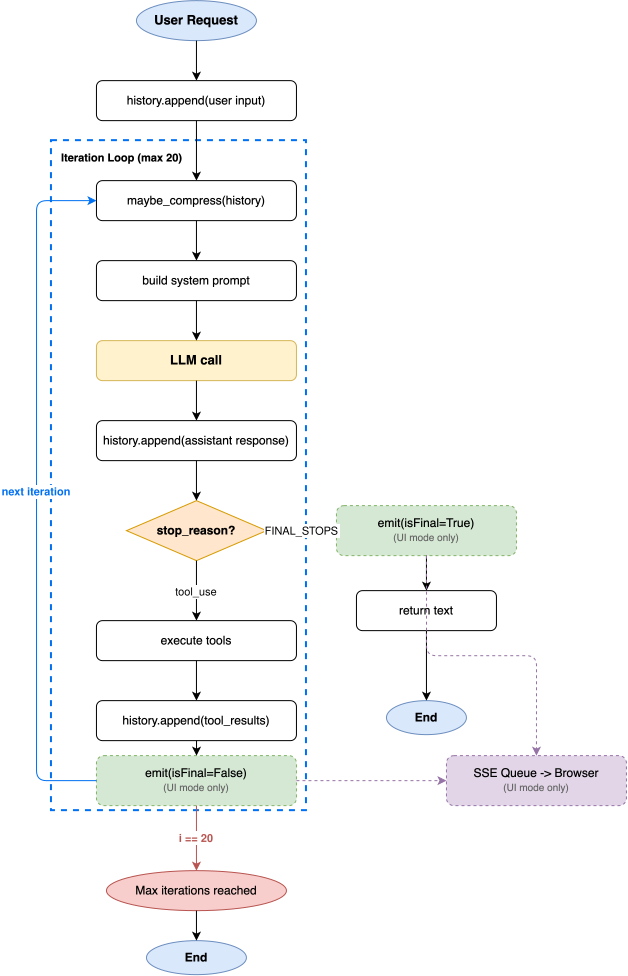

**Tianshu** (天枢, *Celestial Pivot*) is the first star of the Big Dipper — the fixed point around which the northern sky revolves.

Name the goal. Tianshu thinks, plans, and executes — step by step, until done.

**枢运北斗，御动九天。**

说出目标，天枢自行思考、拆解、执行，直至完成。

## Installation

```bash
make install
```

## Setup

Create a `.env` file in your project root:

```bash
ANTHROPIC_API_KEY=your_anthropic_api_key
ANTHROPIC_BASE_URL=http://localhost:6655/anthropic
TAVILY_API_KEY=your_tavily_api_key
AGENT_MODEL=anthropic--claude-4.6-sonnet  # optional, defaults to claude-4.5-sonnet
```

## Usage

### CLI mode

```bash
make run
```

Multi-turn conversation in the terminal, running against the current directory.

### UI mode

```bash
# Terminal 1 — start the backend
make serve                   # run against the tianshu repo itself
make serve PROJECT=myproject # run against a sibling directory named myproject

# Terminal 2 — start the frontend
cd ui && npm run dev
```

Then open `http://localhost:8080/index.html` in the browser. You get a visual canvas with the agent graph, dependency links, per-agent context stats, and a chat panel.

## Features

- **Chat mode**: multi-turn conversation with full context
- **Auto plan**: the model decides whether to decompose complex tasks — no manual trigger needed
- **Skills**: predefined step sequences for common workflows; auto-matched by semantics or triggered manually with `/skill-name`
- **Tool use**: read/write files, run shell commands, search code, fetch web pages
- **Long-term memory**: important information persisted across sessions; two scopes — global (`~/.tianshu/memory/`) for cross-project preferences, project-level (`<cwd>/.tianshu/memory/`) for project-specific facts; index injected into system prompt, full content loaded on demand
- **Context compression**: long conversations are compressed automatically to stay within the context window

## Architecture


### Single Agent Request Flow



## Project Structure

```
tianshu/
├── main.py                    # CLI entry point, banner, input loop
└── agent/
    ├── __init__.py            # re-exports Agent
    ├── core.py                # Agent class: chat / execute / execute_skill, system prompt builder
    ├── planner/
    │   ├── __init__.py        # re-exports Planner, PlanExecutor, Replanner
    │   └── core.py            # goal decomposition, parallel execution, dynamic replanning
    ├── tools/
    │   ├── __init__.py        # re-exports TOOLS, TOOL_MAP, Tool
    │   └── core.py            # 12 built-in tools
    ├── skills/
    │   ├── __init__.py        # re-exports Skill, SkillLoader
    │   ├── core.py            # Skill dataclass + SkillLoader (load / match / find)
    │   └── builtin/           # built-in skill YAMLs (run_and_fix_tests, code_review)
    └── memory/
        ├── __init__.py        # re-exports ContextManager, LongTermMemory
        ├── context.py         # ContextManager: conversation compression
        └── longterm.py        # LongTermMemory: MEMORY.md index + per-entry files; global (~/.tianshu) + project scopes
```

### Chat mode

```
user input
  │
  ▼
Agent.chat()
  │
  ├─ System prompt (built once at init, reused across turns)
  │    ├── base instructions (role, tool-use principles)
  │    ├── project type detection (pyproject.toml / package.json / go.mod …)
  │    ├── top-level directory listing (up to 40 entries)
  │    ├── repo outline (all def / class with line numbers)
  │    ├── git status & branch
  │    └── long-term memory index (global ~/.tianshu/memory/MEMORY.md + project .tianshu/memory/MEMORY.md)
  │
  ├─ ContextManager.prepare()
  │    ├── step 1: spill oversized tool results to .tianshu/tool-results/
  │    ├── step 2: archive message middle to .tianshu/transcripts/ when count ≥ 50
  │    ├── step 3: replace seen tool results with disk refs if chars > 400K
  │    └── step 4: LLM compact as last resort
  │
  └─ Tool-use loop (up to 10 iterations)
       │
       ├── API call (history + 12 tool schemas)
       │
       ├── stop_reason = end_turn ──→ return text to user
       │
       └── stop_reason = tool_use
            ├── file ops      read_file / write_file / edit_file / create_directory
            ├── code nav      get_outline / find_symbol / grep_files / list_files
            ├── shell         bash
            ├── web           web_search / web_fetch
            └── memory        save_memory / delete_memory / read_memory
                 │
                 └── truncated tool result appended to history → next iteration
```

### Plan mode (auto-triggered or `/skill-name`)

```
user input
  │
  ├─ starts with / → SkillLoader.find() → exact skill match → Agent.execute_skill()
  │
  └─ plain input → Agent.execute()
       │
       ├─ SkillLoader.match() (semantic match) → hit → use predefined steps directly
       │
       └─ Planner.decompose() (LLM decides)
            ├─ needs_plan=false → Agent.chat() (plain conversation)
            └─ needs_plan=true  → Plan { steps: [...] }
                    │
                    ▼
              PlanExecutor.execute()
                    │
                    ├── create shared workspace .tianshu/workspace/<uuid>/
                    │
                    ├─ scheduling loop (ThreadPoolExecutor, max_workers=4)
                    │    └── find all steps whose depends_on are satisfied, submit concurrently
                    │
                    ├─ each step (independent Agent)
                    │    ├── new Agent instance (reuses parent system prompt)
                    │    ├── prompt: overall goal + current step + prerequisite output file paths
                    │    └── Agent.chat() → full tool-use loop → record result
                    │
                    ├─ on step failure → Replanner.replan()
                    │    └── LLM decides: skip / retry (new description) / replace remaining steps
                    │
                    └── summary: all done → output summary / partial failure → list failed steps
```

---

## Agent iteration plan

### Phase 1: Basic agent (complete)

**What:** custom tool system, ReAct loop, memory management.

**Why:** a useful agent needs three primitives — access to the outside world (tools), multi-step reasoning (ReAct loop), and cross-turn memory (short-term compression + long-term persistence). None of these is optional: without tools the agent can only talk, without a loop it cannot handle complex tasks, without memory every conversation starts from zero.

**Key components:**
- `tools/core.py`: 12 built-in tools (file I/O, code navigation, bash, web, memory)
- `agent/core.py`: ReAct loop, up to 20 iterations
- `memory/context.py`: short-term memory — 4-step compression pipeline (spill to disk → archive middle → demote seen results → LLM summary)
- `memory/longterm.py`: long-term memory — `MEMORY.md` index + per-entry files; global (`~/.tianshu/memory/`) + project (`.tianshu/memory/`) scopes

---

### Phase 2: Plan mode (complete)

**What:** Planner (goal decomposition) + PlanExecutor (per-step independent execution).

**Why:** the ReAct loop has two hard limits. First, `_MAX_ITERATIONS = 10` — complex tasks need far more than 10 tool calls. Second, history grows unboundedly — a multi-step task inflates context until the model "forgets" earlier work. Plan mode solves this with divide-and-conquer: one LLM call decomposes the goal into 3–8 steps, then each step runs in its own Agent with its own history.

**Key components:**
- `Planner.decompose()`: single LLM call, outputs a step list
- `PlanExecutor.execute()`: instantiates an independent Agent per step, passes the previous step's result (first 200 chars) as context

---

### Phase 3: Multi-agent orchestration (complete)

**What:** parallel execution (DAG dependencies), shared workspace, dynamic replanning.

**Why:** phase 2 steps were strictly sequential — even independent steps had to wait for each other. Real tasks (e.g. "analyze 5 files and summarize") can run concurrently. Also, 200-char summaries are too small to share large artifacts between steps. And abandoning the entire plan on a single failure is too costly — the model should decide how to recover.

**New capabilities:**
- **Parallel execution**: `Step.depends_on` defines a DAG; `ThreadPoolExecutor` runs all steps whose dependencies are satisfied concurrently
- **Shared workspace**: each plan creates `.tianshu/workspace/<uuid>/`; steps write files there and downstream steps read them by path
- **Dynamic replanning**: on step failure, `Replanner` asks the LLM to `skip` / `retry` / `replace` remaining steps (up to 3 times)

---

### Phase 4: Auto plan triggering and skills (complete)

**What:** remove the explicit `/plan` command; introduce a reusable skill system.

**Why removing `/plan`:** it exposes an internal implementation detail. Complexity judgment is the model's responsibility, not the user's. `Planner` now includes a `needs_plan` field in its prompt — the model returns `None` for simple tasks (falls back to `chat()`) or a `Plan` for complex ones, transparently.

**Why skills:** high-frequency workflows (e.g. "run tests and fix failures", "review recent changes") had to be re-planned from scratch every time, wasting tokens and risking inconsistent plans. Skills are predefined step sequences stored as YAML — they can be auto-matched when the user's input is semantically close, or triggered precisely with `/skill-name`.

**Key components:**
- `Skill`: pure data class with `name`, `description`, `steps`
- `SkillLoader`: loads `builtin/*.yaml`; provides `find()` (exact match) and `match()` (single LLM semantic match)
- `Planner.decompose()`: tries skill match first; falls back to LLM planning; returns `None` if `needs_plan=false`
- `Agent.execute_skill()`: converts Skill → Plan → PlanExecutor; `main.py` stays unaware of internals

---

### Phase 5: Optimization (in progress)

#### O1: Context compression — 4-step pipeline (complete)

**What:** replaced the single-step LLM summarization with a four-step compression pipeline modeled on Claude Code's internal design.

**Why the old design was insufficient:** `ContextManager` had one mechanism — compress everything into an LLM summary and keep the last `min_window=4` messages. This discarded data irreversibly: tool results were lost once compressed. The `min_window` was a fixed count, so a `tool_use` + `tool_result` pair each consumed one slot, leaving almost no usable context after compression. Large tool outputs were truncated in-place by `_truncate_result`, again losing data permanently.

**The four steps (run before every API call):**

| Step | When | What happens |
|------|------|--------------|
| 1. `_tool_result_budget` | always | Latest tool batch total > 100K chars → spill oversized individual results (> 20K) to `.tianshu/tool-results/` |
| 2. `_snip_compact` | always | Message count ≥ 50 → archive the middle to `.tianshu/transcripts/`, replace with a one-line marker |
| 3. `_micro_compact` + `_fit_tool_results` | total chars > 400K | Replace seen old tool results with disk references; keep most recent 3 intact |
| 4. `_compact_history` | still over after step 3 | LLM summarization as last resort; entire history → one summary message |

**Key design shift — demotion not deletion:** every piece of data lands on disk before it leaves context. The model sees a path reference instead of the content, and can retrieve it via `read_file` if needed. Nothing is silently truncated.

**Also added:** `reactive_compact` — emergency fallback if the API returns `prompt_too_long` despite the proactive steps. Keeps the last 5 messages intact, summarizes everything before them, retries once.

---

#### O2: Long-term memory — index + per-entry files, two scopes (complete)

**What:** replaced the single append-only `memory.md` with a structured two-tier memory system.

**Why the old design was insufficient:** `LongTermMemory` appended every note to one file and injected the full content into the system prompt on every turn. The file grew unboundedly with no deduplication, all memories were project-local, and the `save_memory` tool gave the model no structure to work with.

**New design:**

| Aspect | Old | New |
|--------|-----|-----|
| Storage | `<project>/.agent/memory.md` (append-only) | `MEMORY.md` index + one file per entry |
| Scopes | project-only | global (`~/.tianshu/memory/`) + project (`<cwd>/.tianshu/memory/`) |
| Entry format | plain text | frontmatter (`name` / `type` / `description`) + body |
| Types | none | `fact` / `decision` / `preference` / `error` |
| Tools | `save_memory(note)` | `save_memory(slug, type, description, content, scope)` / `delete_memory` / `read_memory` |
| Injection | full file contents | index only (`[Global]` + `[Project]` sections); full entry loaded on demand via `read_memory` |

**Directory convention** (mirrors Claude Code's `.claude/` + `~/.claude/`):
- `<project>/.tianshu/` — project-level runtime data and memory
- `~/.tianshu/memory/` — global memory shared across all projects
