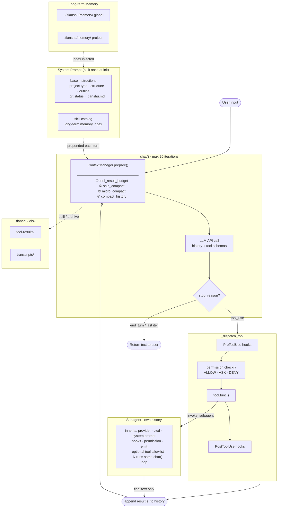

**Tianshu** (天枢, *Celestial Pivot*) is the first star of the Big Dipper — the fixed point around which the northern sky revolves.

Name the goal. Tianshu thinks, plans, and executes — step by step, until done.

**枢运北斗，御动九天。**

说出目标，天枢自行思考、拆解、执行，直至完成。

## Installation

### User (pip install)

```bash
pip install tsagent
```

This installs the `ts` command globally.

### Developer (from source)

```bash
git clone https://github.com/your-org/tianshu
cd tianshu
make install
```

## Configuration

### User

Create `~/.tianshu/.env`:

```bash
OPENAI_API_KEY=your_api_key
AGENT_MODEL=gpt-5               # optional; defaults to gpt-5; prefix "claude" → Anthropic, otherwise → OpenAI
TAVILY_API_KEY=your_tavily_key  # optional, for web_search
```

This file is the global config and is loaded for every `ts` invocation regardless of where you run it. Environment variables already set in your shell take precedence.

The local proxy (`http://localhost:6655/openai/v1`) is used as the OpenAI-compatible endpoint. Set `OPENAI_API_KEY` to authenticate.

### Developer

Create a `.env` file in the repo root. It overrides `~/.tianshu/.env` for values set in both.

```bash
OPENAI_API_KEY=your_api_key
AGENT_MODEL=gpt-5
TAVILY_API_KEY=your_tavily_key
```

## Usage

### User

```bash
cd /path/to/your/project
ts
```

Starts the server and opens the web UI at `http://localhost:8000`. Ctrl+C to quit.

### Developer

```bash
cd /path/to/your/project
make run        # equivalent to .venv/bin/ts
```

## Features

### ReAct loop & tools

The core of Tianshu is a tool-use loop that runs up to 20 iterations per turn. Each iteration: call the model with the current history and tool schemas → if the model returns tool calls, execute them and append results → if the model returns text, the turn ends. The model decides when it is done; there is no forced planning pass in front of every request.

On the last iteration, `tool_choice` is set to `none` so the model produces a text summary of what it has done rather than cutting off mid-task.

The built-in tools are:

| Category | Tools |
|----------|-------|
| File I/O | `read_file`, `write_file`, `edit_file`, `create_directory` |
| Code navigation | `get_outline`, `find_symbol`, `list_files`, `grep_files` |
| Shell | `bash` |
| Web | `web_search`, `web_fetch` |
| Memory | `save_memory`, `read_memory`, `delete_memory` |
| Agent | `todo_list_write`, `invoke_subagent`, `use_skill` |

### Concurrent tool execution

When the model issues multiple tool calls in a single step, read-only tools run concurrently (via `ThreadPoolExecutor`) and their results are merged back in the original call order before being appended to history. Write-type tools are held until all concurrent reads complete. This makes a common pattern — "read three files and then edit one" — meaningfully faster.

### Self-directed planning

The agent has two tools for managing complex tasks:

- **`todo_list_write`**: a full-replace checklist (`pending` / `in_progress` / `completed`). The model calls this whenever it wants to lay out a task breakdown or track progress. The web UI renders it live and fades it out once everything is done. Near-zero cost — it is just a list stored on the agent, not a subagent spawn.
- **`invoke_subagent`**: delegates an isolated chunk of work to a fresh agent with its own history. The parent's context stays clean; only the final result comes back. Supports an optional tool allowlist so a subagent can be restricted to read-only tools.

Whether to use either tool is the model's decision, made in context while working — not a forced pre-pass that pre-judges every request.

### Memory management

**Long-term memory** persists important information across sessions in a two-scope, two-tier structure:

- **Two scopes**: global (`~/.tianshu/memory/`) for cross-project preferences and facts; project-level (`<cwd>/.tianshu/memory/`) for project-specific knowledge.
- **Two tiers per scope**: a `MEMORY.md` index (one line per entry, injected into every system prompt) plus one file per memory entry. The index is always loaded; full entry content is fetched on demand via `read_memory`.
- **Typed entries**: each entry carries a frontmatter `type` field (`fact` / `decision` / `preference` / `error`) and a `description` field used to decide relevance without reading the body.

The model manages memory with `save_memory`, `read_memory`, and `delete_memory`. Only the index is in-context by default, keeping the system prompt lean regardless of how many entries accumulate.

**Context compression** keeps long conversations within the context window through a four-step pipeline before each API call, prioritizing demotion over deletion — every piece of data reaches disk before it leaves context, and the model can retrieve it via `read_file` if needed:

| Step | Trigger | What happens |
|------|---------|--------------|
| 1. `_tool_result_budget` | always | Latest tool batch total > 100K chars → spill oversized results (> 20K) to `.tianshu/tool-results/` |
| 2. `_snip_compact` | always | Message count ≥ 50 → archive the middle segment to `.tianshu/transcripts/`, replace with a one-line marker |
| 3. `_micro_compact` + `_fit_tool_results` | total chars > 400K | Replace old seen tool results with disk references; keep the most recent 3 intact |
| 4. `_compact_history` | still over after step 3 | LLM summarization as last resort; full history → one summary message |

If the API returns `prompt_too_long`, a reactive compact fires immediately: summarize everything except the last 5 messages and retry once.

### Skills

Skills are reusable workflows for tasks you run repeatedly — code review, running and fixing tests, or any multi-step sequence you want the agent to follow consistently. Without skills, the model re-plans the same kind of task from scratch every time, wasting tokens and producing inconsistent results.

A skill is a YAML file with a name, description, and a list of steps. Place them in `~/.tianshu/skills/` (global, shared across projects) or `<cwd>/.tianshu/skills/` (project-level). A project-level skill with the same name as a global one takes precedence.

The matching is zero-cost: all skill names and descriptions are injected into the system prompt. The model calls the `use_skill(name)` tool when it decides a skill applies; `use_skill` returns the full steps as text and the model executes them with its normal tools — no separate LLM call, no rigid linear plan.

### Permission control

Every tool call passes through a rule engine before it executes:

- `PermissionEngine.check(tool, input)` returns `ALLOW`, `ASK`, or `DENY`; first matching rule wins.
- **Default policy**: read-only tools and safe shell commands auto-allow; `bash`, `write_file`, `edit_file`, `create_directory` ask for confirmation; catastrophic bash commands (`rm -rf /`, fork bombs, `mkfs`, `dd of=/dev/`, shutdown) are hard-denied.
- On `ASK`, the web UI surfaces a confirmation prompt; the agent worker thread blocks on a thread-safe queue until the user responds.
- Subagents inherit the parent's permission callback through the same `_dispatch_tool` path — there is no bypass.

### Hooks

Two extension points wrap every tool call:

```
PreToolUse hooks → permission.check → tool.func → PostToolUse hooks
```

- **Pre hooks** can rewrite the input or block the call entirely before it reaches the permission check.
- **Post hooks** can rewrite the result or run side effects (format, audit, notify) after execution.

Hooks are registered as Python callbacks (`@reg.pre(matcher)` / `@reg.post(matcher)`) or declared as shell commands in `.tianshu/hooks.json` (project-level) and `~/.tianshu/hooks.json` (global). The shell protocol follows the Claude Code convention: JSON over stdin, exit 2 blocks, stdout JSON rewrites. Hook failures and timeouts are caught and degrade to no-op — they never crash the agent loop.

### Multi-provider

Anthropic and OpenAI-compatible backends share a unified `Provider` interface (`call` / `summarize` / `complete`). `make_provider(model)` routes by model name prefix: `"claude-*"` → `AnthropicProvider`, everything else → `OpenAIProvider`. All internal LLM calls — main loop, subagents, context compression summaries — go through this interface.

## Architecture


